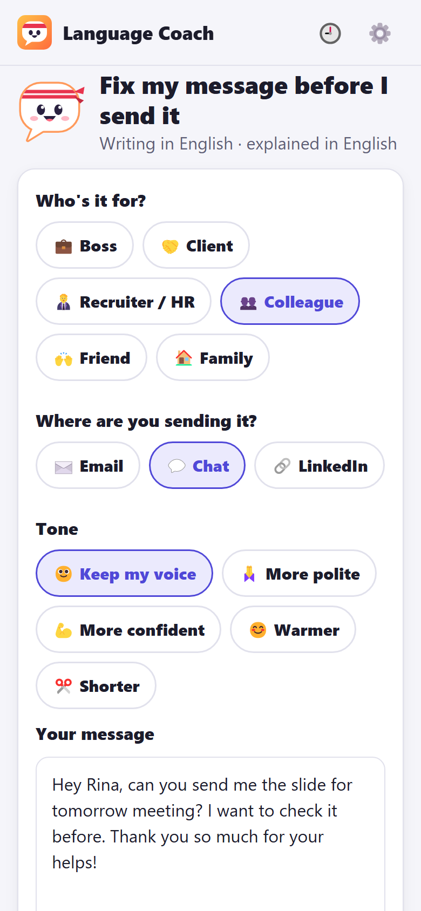
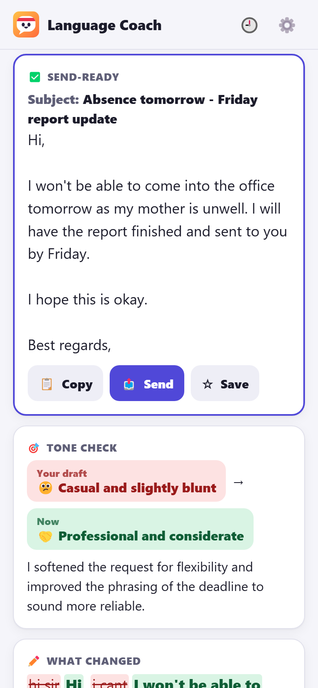
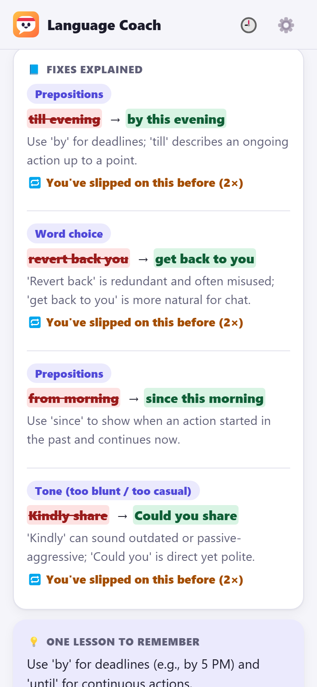
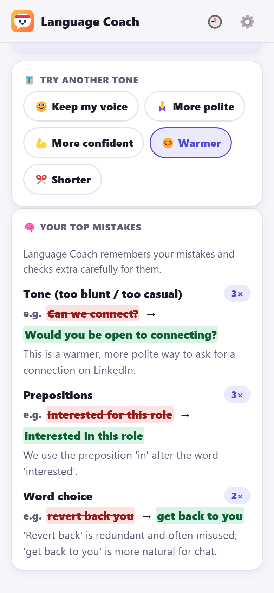
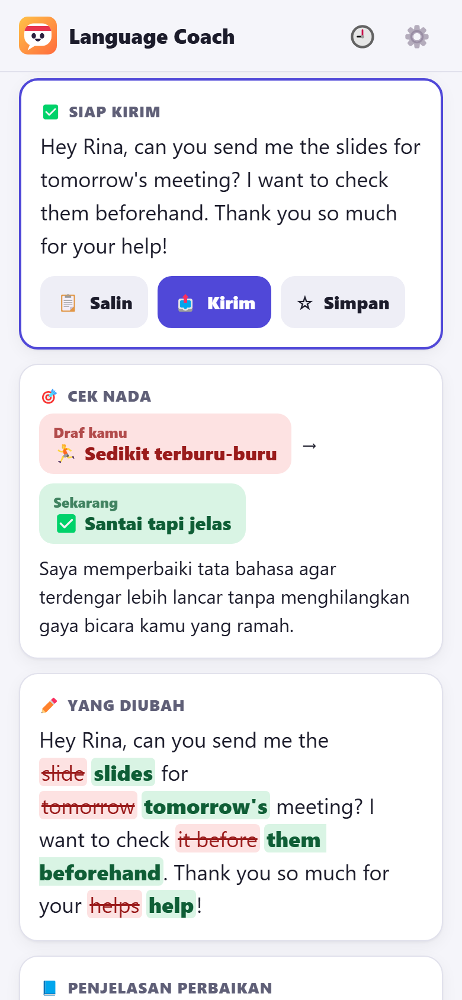
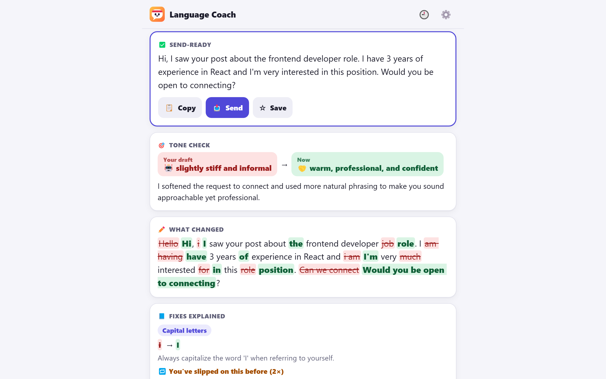

# Language Coach: Fix My Message

**Fix your message before you send it.** Paste an email, chat or LinkedIn message, choose who it's for, where it's going and the tone you want, and get a send-ready version in your own voice. You also get a tone check, every change highlighted and your mistakes explained in your own language. Language Coach remembers your most common mistakes and checks extra carefully for them. Language Coach is an app on [Anna](https://anna.partners).

- [Privacy policy](privacy/)
- Contact: harshal456951@gmail.com

## Screenshots

  

 

